# Mechanical Vibrations Analyzer

A compact **mechanical vibration monitoring system** designed to be mounted directly on a machine and visualize its vibration behavior as a **real-time spectrogram**.

The device is designed around a custom PCB, a mechanical enclosure, and an embedded vibration-sensing system. After mounting the unit to a machine using screws, the machine can be operated while its vibration characteristics are displayed on the onboard screen as a frequency-versus-time spectrogram.

> **Project status:** Hardware design completed.

## Project Overview

The main idea of the project is to provide a self-contained vibration-monitoring device that can be physically attached to machinery and used to observe its vibration spectrum.

### Basic workflow

1. Mount the analyzer to the machine using the enclosure mounting points.
2. Operate the machine under the desired condition.
3. Capture mechanical vibrations using the onboard vibration sensor.
4. Process the measured vibration data.
5. Display the resulting frequency content as a spectrogram on the device's screen.

This makes it possible to visually observe how the machine's vibration spectrum changes over time.

## Hardware Design

The hardware was designed as a custom PCB specifically for the vibration-monitoring application. The repository contains the KiCad design files together with the supporting 3D/CAD files used during the mechanical design process.

### PCB 3D Views

The following renders show the assembled PCB from different viewing angles.

<table>
<tr>
<td align="center" width="33%">
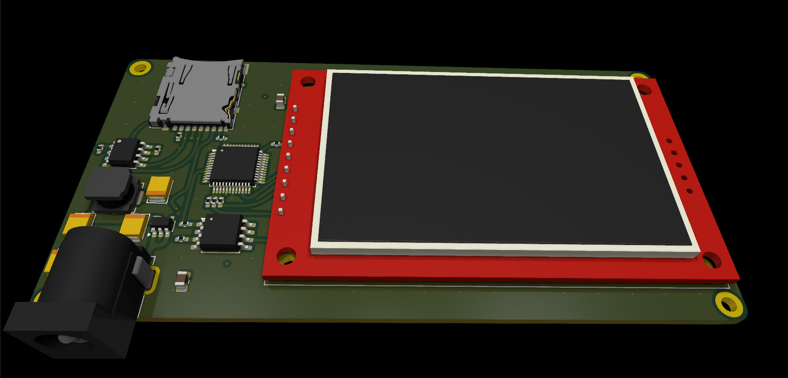 
<b>PCB 3D View — Front Perspective</b> 
Three-dimensional view of the completed PCB from a front perspective.
</td>
<td align="center" width="33%">
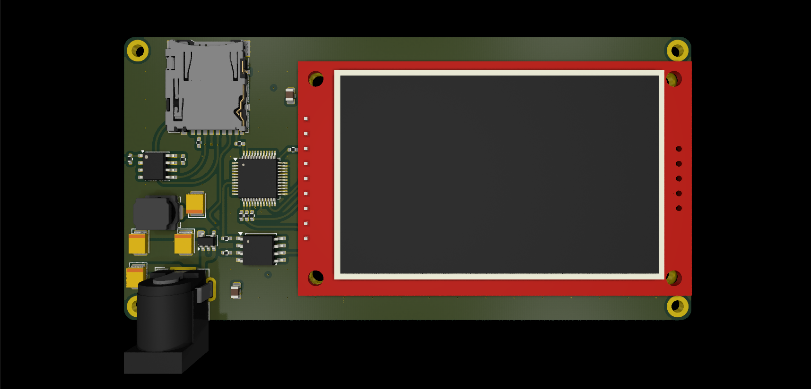 
<b>PCB 3D View — Rear Perspective</b> 
Three-dimensional view showing the opposite side of the assembled board.
</td>
<td align="center" width="33%">
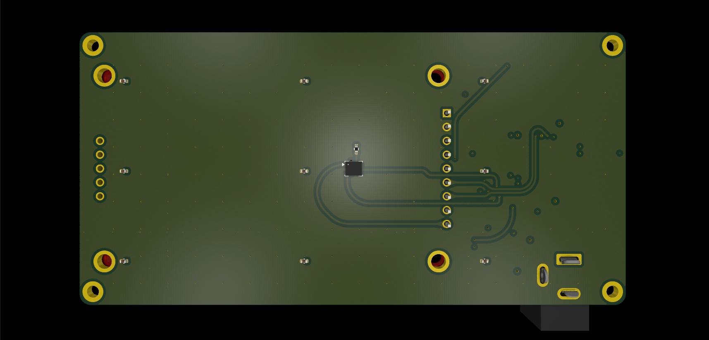 
<b>PCB 3D View — Overall Assembly</b> 
Additional 3D perspective highlighting the board layout and component placement.
</td>
</tr>
</table>

## PCB Layer Stackup

The next renders show the complete PCB layer arrangement followed by the individual layers in order.

<table>
<tr>
<td align="center" width="33%">
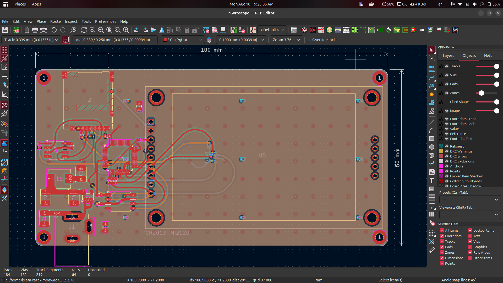 
<b>Complete PCB Layer Stack</b> 
All six PCB layers shown together to illustrate the complete board layout.
</td>
<td align="center" width="33%">
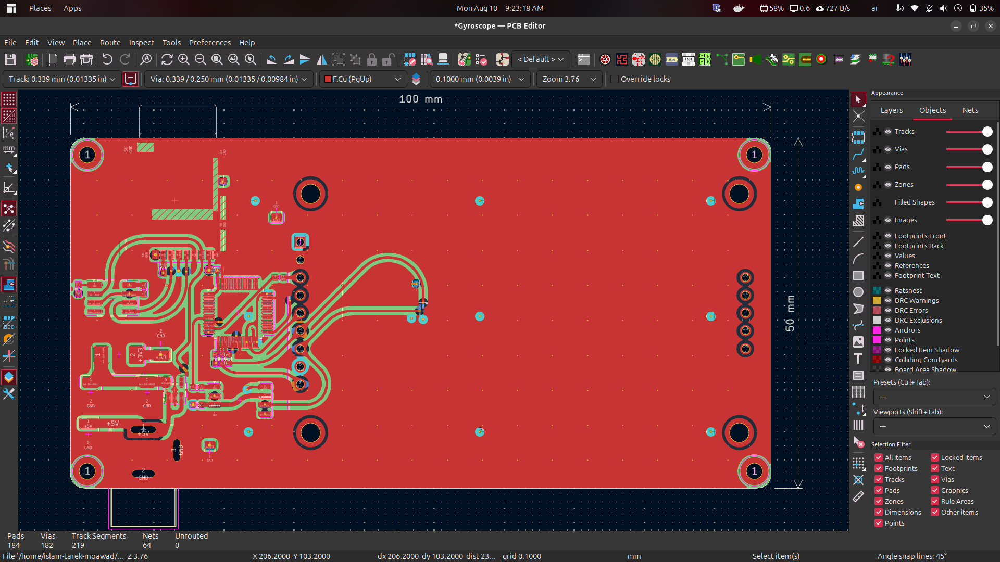 
<b>Layer 1</b> 
First individual PCB layer in the layer sequence.
</td>
<td align="center" width="33%">
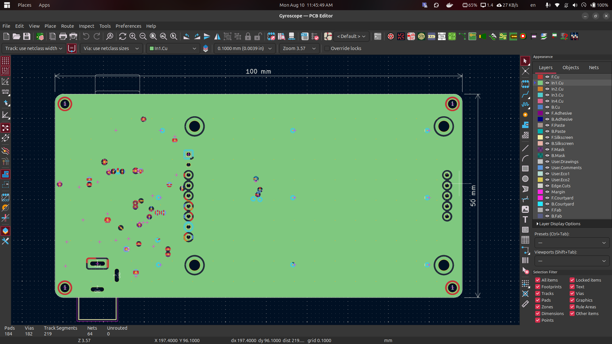 
<b>Layer 2</b> 
Second individual PCB layer in the layer sequence.
</td>
</tr>
<tr>
<td align="center" width="33%">
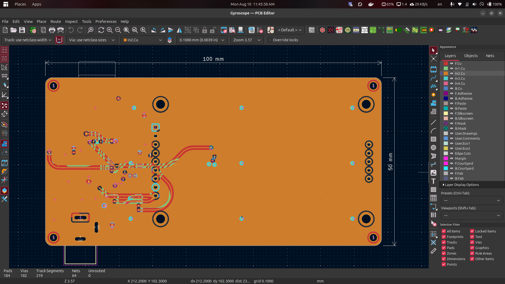 
<b>Layer 3</b> 
Third individual PCB layer in the layer sequence.
</td>
<td align="center" width="33%">
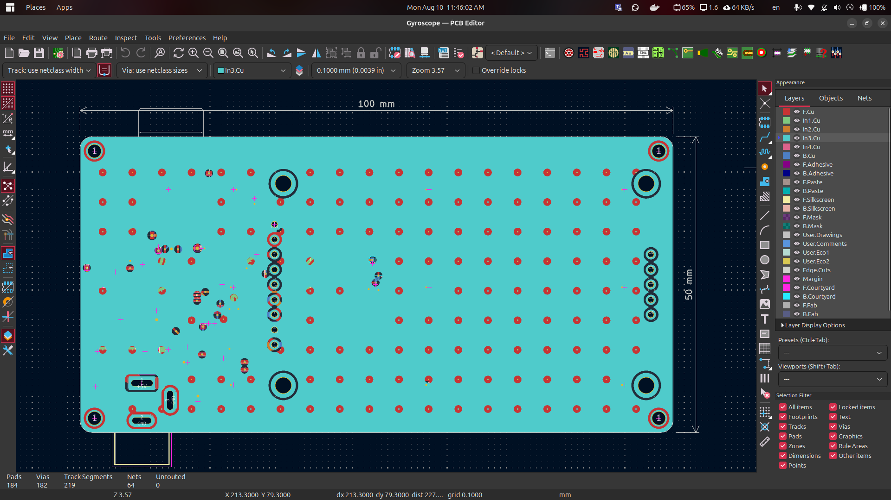 
<b>Layer 4</b> 
Fourth individual PCB layer in the layer sequence.
</td>
<td align="center" width="33%">
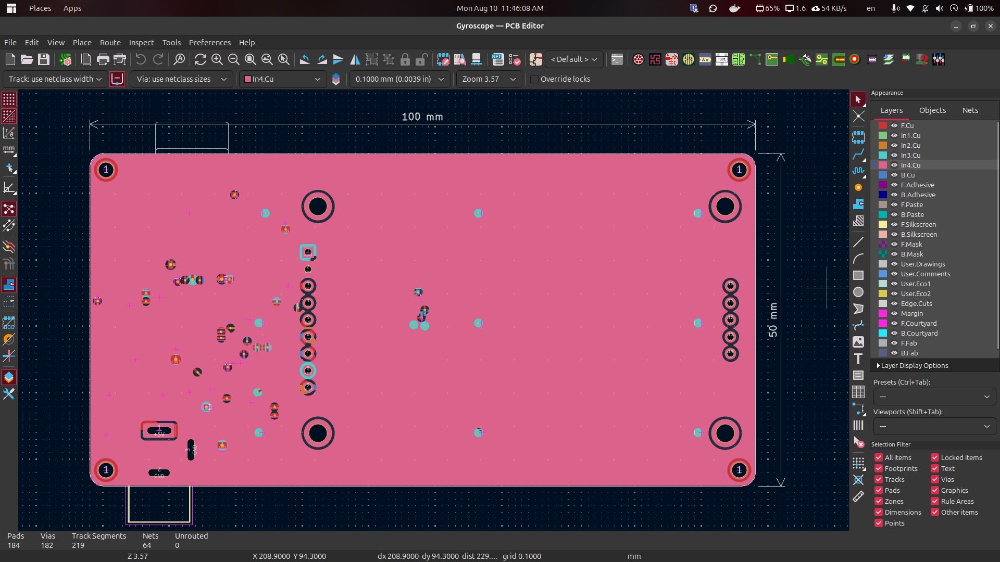 
<b>Layer 5</b> 
Fifth individual PCB layer in the layer sequence.
</td>
</tr>
<tr>
<td align="center" width="33%">
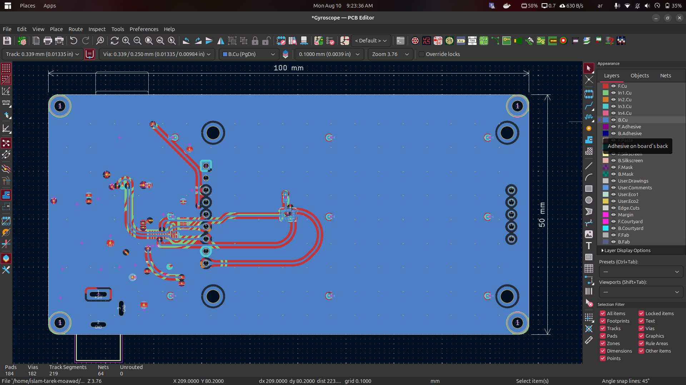 
<b>Layer 6</b> 
Sixth and final individual PCB layer in the layer sequence.
</td>
<td></td>
<td></td>
</tr>
</table>

## Mechanical Enclosure

A dedicated enclosure was designed for the PCB using **FreeCAD**. The enclosure provides a physical housing for the electronics and allows the analyzer to be securely mounted to the machine during measurements.

<table>
<tr>
<td align="center" width="50%">
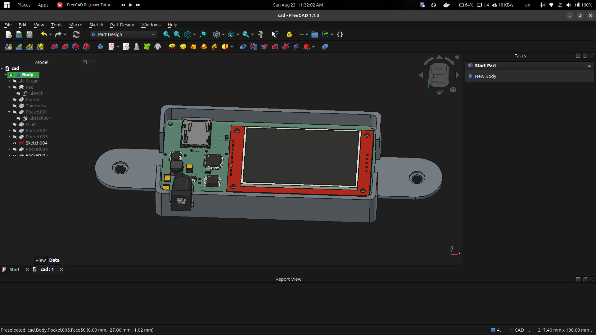 
<b>FreeCAD Enclosure — Design View</b> 
CAD model of the custom enclosure designed around the PCB.
</td>
<td align="center" width="50%">
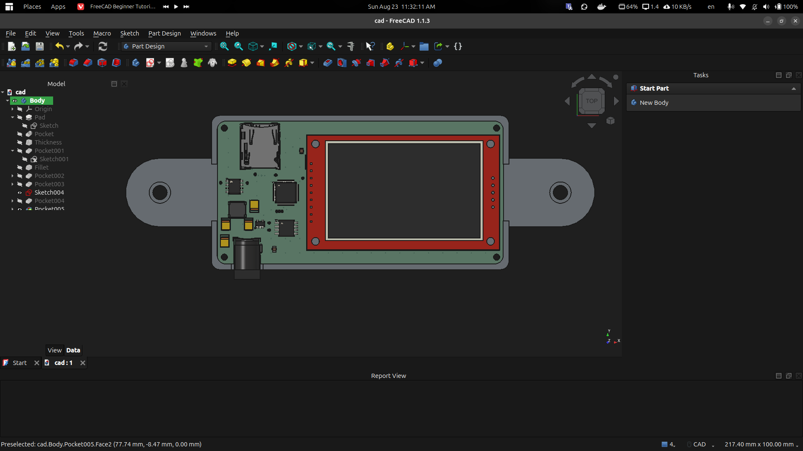 
<b>FreeCAD Enclosure — Final View</b> 
Additional enclosure view showing the mechanical housing and mounting geometry.
</td>
</tr>
</table>

## Design Files

The repository includes the main hardware-design files used to develop the analyzer, including:

- **KiCad schematic and PCB files** for the electronic design.
- **3D component models** used for PCB visualization.
- **FreeCAD/CAD-related files** for the mechanical enclosure.
- Supporting configuration and project files used during PCB development.

## Applications

The analyzer can be used as a compact tool for observing vibration behavior in rotating or mechanically moving equipment. A spectrogram provides a convenient way to see both the frequency content and how it evolves over time.

Potential uses include:

- Machine vibration monitoring
- Mechanical system diagnostics
- Observation of rotating machinery vibration
- Experimental vibration analysis
- Educational demonstrations of frequency-domain analysis

## Project Post

More details about the hardware development and the project progress are available in the project's LinkedIn post:

**[Mechanical Vibrations Analyzer — Hardware Development](https://www.linkedin.com/posts/islamhufe_%D8%AE%D9%84%D8%B5%D8%AA-%D8%A7%D9%85%D8%A8%D8%A7%D8%B1%D8%AD-%D8%AC%D8%B2%D8%A1-%D8%A7%D9%84%D9%87%D8%A7%D8%B1%D8%AF%D9%88%D9%8A%D8%B1-%D9%85%D9%86-%D9%85%D8%B4%D8%B1%D9%88%D8%B9-%D8%A8%D8%A7%D8%B3%D9%85-mechanical-activity-7492970094948519936-9O9D)**

## Author

**Islam Tarek Moawad**

Designed and developed as an embedded hardware project combining **PCB design, vibration sensing, signal analysis, embedded systems, and mechanical CAD**.
